# 🌟 Awesome Customer Service & Support Platforms 🌟

**🚀 Curated Directory of Open-Source Helpdesks, Omnichannel SaaS Suites, AI Ticketing & Self-Hosted CX Infrastructure**

*Focused on Shared Inboxes 📥, SLA Management ⏱️, Automated AI Deflection 🤖, and Helpdesk Workflows 🛠️*

📅 **Last updated: November 2026**

---

## 📖 Overview & Ecosystem Guide

This repository tracks top-tier **open-source projects** 🔓 and leading **SaaS platforms** ☁️ for **Customer Service & Support Platforms**. Modern support infrastructure empowers customer success, IT, and operations teams to unify multi-channel conversations (Email, Live Chat, WhatsApp, SMS, Social Media), orchestrate automated ticket routing, fulfill strict Service Level Agreements (SLAs), and leverage autonomous AI agents for high-resolution ticket deflection.

Whether you require a **fully managed enterprise CX suite** with outcome-based generative AI pricing or a **production-ready self-hosted helpdesk** ensuring 100% data sovereignty and zero seat fees, this directory provides transparent benchmarks to guide your software architecture decisions.

---

## 📑 Table of Contents

- [📊 Sector Overview & Market Dynamics](#-sector-overview--market-dynamics)
- [☁️ SaaS & Hosted Support Platforms](#️-saas--hosted-support-platforms)
- [🔓 Open-Source GitHub Projects](#-open-source-github-projects)
- [🤝 How to Contribute](#-how-to-contribute)
- [💖 Support & Sponsorship](#-support--sponsorship)
- [📈 Star History](#-star-history)
- [⚖️ Disclaimer](#️-disclaimer)

---

## 📊 Sector Overview & Market Dynamics

The global customer service and support software market is estimated between **$25B and $55B** (projected to surpass $70B+ by 2030, compounding at 12–19% CAGR). The sector exhibits a **moderately concentrated, hybrid market structure**: multi-product enterprise giants (Salesforce, ServiceNow, Zendesk, HubSpot) concentrate large-scale corporate spend through unified CRM ecosystems and high switching costs, while the lower and mid-market remains **highly fragmented** with specialized point solutions competing aggressively on AI agent automation, omnichannel inboxes, and transparent seat economics.

---

## ☁️ SaaS & Hosted Support Platforms

| 🏢 Platform | 💰 Company Scale (Revenue / Valuation) | 🏷️ Pricing (Specific Starting Tiers) | 🎁 Free Tier Limits / Free Trial Limits | 🎯 Key Focus & Best For |
| :--- | :--- | :--- | :--- | :--- |
| **[Salesforce Service Cloud](https://www.salesforce.com/)** | **~$200B Market Cap** ($41.5B FY26 Revenue) | **Starter Suite at $25/user/month** (annual/monthly); Pro Suite at $100/user/month; Enterprise at $175/user/month; Unlimited at $350/user/month | **No permanent free tier**; **30-day free trial** with case management and CRM capabilities (no credit card required) | Enterprise service platform deeply unified with Salesforce CRM, case routing, and Agentforce |
| **[ServiceNow CSM](https://www.servicenow.com/)** | **~$160B Market Cap** ($14.5B+ ARR / 2026 pacing) | **Fulfiller seats from ~$100–$140/fulfiller/month** (annual contract; sales quoted); Now Assist AI add-on from ~$75/user/month | **No standard free trial or self-serve free tier**; testing requires sales-assisted POC demo or developer sandbox (PDI) restricted to non-production code | Large enterprises integrating customer service operations tightly with IT service management (ITSM) |
| **[Zoho Desk](https://www.zoho.com/desk/)** | **~$12.5B Valuation** ($1.5B FY25 Revenue, bootstrapped) | **Express at $9/user/month** (annual billing, 5-user cap); Standard at $20/user/month; Professional at $35/user/month; Enterprise at $50/user/month | **Free forever plan: capped at 3 agents**, 1 email inbox, basic web forms, private knowledge base (no live chat or SLA automations) | Cost-effective customer ticketing for SMBs and organizations integrated into the Zoho ecosystem |
| **[HubSpot Service Hub](https://www.hubspot.com/)** | **~$11.2B Market Cap** ($3.7B 2026 ARR) | **Starter at $20/seat/month** ($15/seat/month annual); Professional at $100/seat/month; Enterprise at $150/seat/month | **Free forever plan: up to 2 users**, 1 shared inbox, 1 ticket pipeline, 1,000 CRM contacts, with HubSpot branding | Growing businesses wanting customer support tickets unified with inbound marketing and CRM records |
| **[Zendesk Support](https://www.zendesk.com/)** | **~$10.2B Buyout Valuation** (~$2.0B ARR) | **Support Team at $19/agent/month** (annual); Suite Team at $55/agent/month; Suite Growth at $89/agent/month; Suite Professional at $115/agent/month | **No permanent free tier**; **14-day free trial** of Suite Professional (extendable once up to 28 days upon admin request; no credit card required) | Mature, omnichannel support with extensive integration marketplace and AI resolution add-ons |
| **[Freshdesk](https://www.freshworks.com/freshdesk/)** | **~$4.0B Market Cap** (~$900M ARR / TTM) | **Growth at $19/agent/month** ($15/agent/month annual); Pro at $49/agent/month; Enterprise at $79/agent/month | **No permanent free tier on current pricing page**; **14-day free trial** of Enterprise tier (API capped at 50 calls/min) or 6-month startup evaluation capped at 2 agents | Mid-market teams wanting modern multi-channel support and Freddy AI deflection at lower entry costs than Zendesk |
| **[Intercom](https://www.intercom.com/)** | **~$3.6B Valuation** (~$400M ARR; acquired by Salesforce) | **Essential from $39/seat/month** (or entry promotions from $0.99/seat/mo) + **Fin AI at $0.99/resolution**; Advanced at $85/seat/month; Expert at $132/seat/month | **No permanent free tier**; **14-day free trial** of platform and Fin AI agent (cardless, optional 7-day self-serve extension) | AI-first customer engagement prioritizing outcome-based autonomous deflection and conversational messenger |
| **[Gladly](https://www.gladly.com/)** | **~$275M Valuation** (~$48M ARR) | **Hero at $180/agent/month** (enforces minimum 10 users = $1,800/mo); Superhero at $210/agent/month (min 45 users); Sidekick AI at $0.60/resolution | **No self-serve free tier or public trial**; guided sales pilot/POC only with annual commitments typically starting at $100K+/year | Enterprise retail and DTC eCommerce brands needing unified customer conversation timelines across all channels |
| **[Kustomer](https://www.kustomer.com/)** | **~$250M Valuation** (~$30M ARR) | **Enterprise at $89/user/month** (annual contract only, 8-seat minimum = $712/mo); Ultimate at $139/user/month; AI add-on at ~$0.60/conversation | **No permanent free tier and no self-serve free trial**; evaluation requires a scheduled live demo with sales engineering | Mid-market to high-volume CX teams requiring CRM data timelines and AI-driven automation |
| **[Help Scout](https://www.helpscout.com/)** | **~$35M ARR** (Private / Bootstrapped-leaning) | **Standard at $25/user/month** ($20/user/month annual); Plus at $45/user/month; Pro at $75/user/month; AI Answers at $0.75/resolution | **Free forever plan: up to 5 users**, 1 shared inbox, 1 Docs site (up to 10 articles), capped at **100 contacts helped/month** (3-month trial of Scout AI) | Small to mid-sized teams wanting a clean, collaborative email-first shared inbox and straightforward knowledge base |

---

## 🔓 Open-Source GitHub Projects

All open-source repositories below are sorted in **descending order by GitHub stargazers count** ⭐. Each project includes a real-time badge linking directly to its repository stargazers page.

- **[Chatwoot](https://github.com/chatwoot/chatwoot)** 
  - **License**: MIT 📜 | **Tech Stack**: Ruby on Rails, Vue.js, PostgreSQL, Redis 🛠️
  - **Description**: Leading open-source omnichannel customer engagement suite and live chat platform. Unifies conversations from website live chat, WhatsApp, Twitter/X, Facebook, Telegram, and Email into a single collaborative shared inbox. Features mobile apps (iOS & Android), agent automations, CSAT surveys, and custom webhook integrations.
  - **Best For**: Modern teams needing a true open-source alternative to Intercom, Crisp, or Zendesk Chat.

- **[UVdesk Community](https://github.com/uvdesk/community-skeleton)** 
  - **License**: OSL-3.0 📜 | **Tech Stack**: PHP, Symfony Framework, MySQL 🛠️
  - **Description**: Extensible open-source helpdesk ticketing system designed for multi-channel email piping and ticket workflows. Offers unlimited agents, unlimited tickets, team dispatch workflows, and knowledge base portals with customizable themes.
  - **Best For**: Small-to-medium teams looking for a reliable PHP-based helpdesk architecture with no licensing ceilings.

- **[GLPI Project](https://github.com/glpi-project/glpi)** 
  - **License**: GPL-3.0 📜 | **Tech Stack**: PHP, MariaDB/MySQL, JavaScript 🛠️
  - **Description**: Comprehensive open-source IT Service Management (ITSM) and Service Desk platform compliant with ITIL best practices. Combines incident/request ticketing, problem tracking, change management, asset management (CMDB), and SLA escalation tracking.
  - **Best For**: Enterprise IT departments and universities needing mature ITIL helpdesk and asset lifecycle tracking.

- **[Papercups](https://github.com/papercups-io/papercups)** 
  - **License**: MIT 📜 | **Tech Stack**: Elixir, Phoenix Framework, React, PostgreSQL 🛠️
  - **Description**: Developer-friendly open-source live customer messaging platform. Provides embeddable chat widgets for React, HTML, React Native, and Flutter, with direct Slack and Mattermost inbox synchronization.
  - **Best For**: Software startups and developer-centric teams that want to embed live support chat directly into their web/mobile apps.

- **[Zammad](https://github.com/zammad/zammad)** 
  - **License**: AGPL-3.0 📜 | **Tech Stack**: Ruby on Rails, PostgreSQL, Elasticsearch 🛠️
  - **Description**: Production-grade web-based customer support system and shared inbox. Features omnichannel integration (Email, Chat, Phone/CTI, Twitter, Facebook), real-time ticket updates (collision detection), fine-grained role-based permissions, SLA tracking, and audit logs.
  - **Best For**: Medium-to-large service desks wanting a slick, modern web UI with comprehensive telephone and social integration.

- **[FreeScout](https://github.com/freescout-help-desk/freescout)** 
  - **License**: AGPL-3.0 📜 | **Tech Stack**: PHP, Laravel, MySQL 🛠️
  - **Description**: Lightweight, self-hosted shared inbox and helpdesk written on Laravel. Serves as a 100% community-driven alternative to Help Scout and Zendesk with minimal resource footprints (runs easily on $5 VPS nodes). Supported by an extensive module ecosystem (LDAP, Telegram, WhatsApp, Knowledge Base).
  - **Best For**: Budget-conscious teams and agencies looking for a fast, clean email-first shared inbox.

- **[osTicket](https://github.com/osTicket/osTicket)** 
  - **License**: GPL-2.0 📜 | **Tech Stack**: PHP, MySQL 🛠️
  - **Description**: Battle-tested, widely deployed open-source customer support ticketing engine. Seamlessly routes incoming email, phone, and web form inquiries into a unified web interface with custom ticket fields, ticket filtering rules, auto-responses, and staff collision prevention.
  - **Best For**: Organizations needing proven, straightforward ticket dispatching that runs on standard LAMP hosting environments.

- **[Chaskiq](https://github.com/chaskiq/chaskiq)** 
  - **License**: AGPL-3.0 📜 | **Tech Stack**: Ruby on Rails, React, PostgreSQL 🛠️
  - **Description**: Full-featured open-source conversational marketing and support automation platform. Combines live messenger widgets, proactive in-app customer tours, automated bot workflows, video calls, and email newsletters.
  - **Best For**: SaaS companies looking for an all-in-one Intercom replacement for onboarding, outbound messaging, and inbound customer care.

- **[Frappe Helpdesk](https://github.com/frappe/helpdesk)** 
  - **License**: AGPL-3.0 📜 | **Tech Stack**: Python (Frappe Framework), Vue.js 3, MariaDB, Redis 🛠️
  - **Description**: Modern, open-source ticketing and customer service platform built on the Frappe framework. Features ticket assignment rules by workload/skills, SLA management with working hours, customer self-service portal, and seamless bi-directional integration with ERPNext.
  - **Best For**: Businesses already using Frappe/ERPNext who require unified customer data and zero per-seat licensing fees.

- **[Live Helper Chat](https://github.com/LiveHelperChat/livehelperchat)** 
  - **License**: Apache-2.0 📜 | **Tech Stack**: PHP, MySQL, Node.js / React 🛠️
  - **Description**: Dedicated open-source live support chat application supporting desktop & mobile apps, Telegram, WhatsApp, Twilio, and Facebook Messenger. Includes voice/video calls, proactive automated triggers, canned responses, and bot builders.
  - **Best For**: Companies seeking standalone, ultra-reliable live chat customer support with custom bot integration capabilities.

- **[Trudesk](https://github.com/polonel/trudesk)** 
  - **License**: Apache-2.0 📜 | **Tech Stack**: Node.js, MongoDB, Elasticsearch 🛠️
  - **Description**: Clean, modern open-source helpdesk solution built on Node.js and MongoDB. Provides real-time notifications via WebSockets, ticket management, custom SLA definitions, and knowledge base documentation.
  - **Best For**: Developers and teams seeking a 100% JavaScript/Node.js tech stack for support ticketing.

- **[Request Tracker (RT)](https://github.com/bestpractical/rt)** 
  - **License**: GPL-2.0 📜 | **Tech Stack**: Perl, PostgreSQL/MySQL 🛠️
  - **Description**: Veteran, industrial-strength ticketing engine used by Fortune 500 corporations, universities, and government agencies worldwide. Renowned for granular role-based per-queue permissions, asset tracking, full change auditing, and RESTful APIs.
  - **Best For**: High-security, enterprise, and IT operations teams requiring granular queue permissions and audit compliance.

- **[OTOBO](https://github.com/RotherOSS/otobo)** 
  - **License**: GPL-3.0 📜 | **Tech Stack**: Perl, MariaDB/MySQL/PostgreSQL, Docker 🛠️
  - **Description**: The official community fork of OTRS, carrying forward open-source IT Service Management. Includes free ITSM packages, a responsive customer self-service portal, LDAP/RADIUS authentication, and Docker-compose deployments.
  - **Best For**: IT departments and corporate service organizations looking for an active, cost-free OTRS ITSM alternative.

---

## 🤝 How to Contribute

Contributions are warmly welcomed! 🌟 To add a new platform or update existing benchmarks:

1. **Fork the repository** 🍴.
2. Create a new branch: `git checkout -b feature/add-new-platform`.
3. Add or edit entries in [README.md](README.md) following the established format:
   - Provide verified, specific tier pricing (no ambiguous terms like "Custom" or "Usage-based").
   - Include company scale or verified GitHub star badges.
   - Mention specific free tier limits and trial limits.
4. Verify all markdown links and ensure tables render cleanly.
5. Commit your changes: `git commit -m "Add [Platform Name] customer support tool"`.
6. Push to your branch and submit a **Pull Request** 🚀.

---

## 💖 Support & Sponsorship

If you find this curated directory helpful for evaluating customer support tools and open-source infrastructure:

- ⭐ **Star the repo** on GitHub to help others discover it.
- 🍴 **Fork it** to contribute new benchmarks or create tailored internal comparison sheets.
- 📢 **Share it** on Twitter/X, LinkedIn, or developer forums.
- ☕ **Buy me a coffee / Sponsor**: If you'd like to support ongoing research and maintenance, feel free to sponsor the project via the **[GitHub Sponsor Dashboard](https://github.com/sponsors/ishandutta2007)**! Every bit of support is deeply appreciated! 💖

---

## 📈 Star History

---

## ⚖️ Disclaimer

- This is a **community-curated, independent repository** — inclusion does not represent an endorsement or commercial partnership.
- Customer support systems frequently handle sensitive customer data, personally identifiable information (PII), and intellectual property. Ensure all self-hosted deployments or hosted vendors comply with applicable data protection regulations (GDPR, HIPAA, CCPA, SOC 2).
- Vendor pricing, free trial policies, and tier inclusions are subject to change by vendors over time; always confirm directly with official vendor pricing tables before making purchasing decisions.

---

**Made with ❤️ for customer support engineers, IT leaders, and open-source advocates.**

*Let's build more responsive, transparent, and user-friendly support operations together.* 🚀

